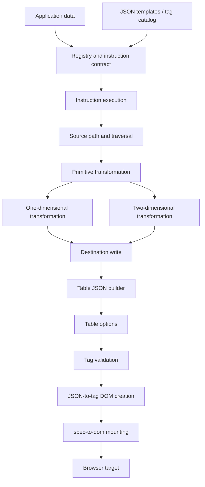

# DOM Builder — Architecture Overview

## The central idea

DOM Builder is organized as a set of small packages that turn structured data and JSON templates into a declarative UI specification, then into browser DOM. Table generation is one important use case, but the architecture is broader: instruction contracts, data access, transformation dimensions, table composition, tag validation, DOM creation, and mounting are separate responsibilities.

## Capability layers

### 1. Instruction system
The instruction packages define a common instruction contract, validate it, and execute either single-dimensional or double-dimensional work. `json-instructions` provides a higher-level entry point over the specialized executors.

### 2. Data access
`json-source-path` locates source values in a registry. `json-traversal` handles nested JSON structures. `json-write-path` places computed values at destination paths. These are distinct read, walk, and write concerns.

### 3. Transformation engines
- **Primitive:** one object + one template → one resolved element description.
- **One dimension:** collection + template → collection of resolved element descriptions.
- **Two dimensions:** columns × row data + row/cell templates → table row/cell descriptions.
- **Facade:** `json-transformer-funcs` groups the lower-level transformation capabilities.

### 4. Table construction
`json-renderers-build-table` assembles a declarative table tree. `json-renderers-build-table-options` decorates that tree with optional table features. These packages operate on JSON descriptions rather than directly mounting browser DOM.

### 5. DOM generation
`spec-repo` provides tag/specification data. `json-to-tag-validate` validates tag descriptions. `@keshavsoft/json-to-tag` creates native elements. `spec-to-dom` mounts nodes. `@keshavsoft/json-to-dom` orchestrates the final generation and mounting steps.

## Conceptual end-to-end flow

This is a conceptual product map, not a guarantee that every arrow represents a direct runtime import. Use each repository's product guide and original documentation to follow exact package APIs.

## Product navigation

- [Instruction system](../01-Instruction-System/json-instructions/PRODUCT-GUIDE.md)
- [Data access](../02-Data-Access/json-source-path/PRODUCT-GUIDE.md)
- [Transformation engines](../03-Transformation-Engines/json-transformer-funcs/PRODUCT-GUIDE.md)
- [Table construction](../04-Table-Construction/json-renderers-build-table/PRODUCT-GUIDE.md)
- [DOM generation](../05-DOM-Generation/keshavsoft-json-to-dom/PRODUCT-GUIDE.md)
